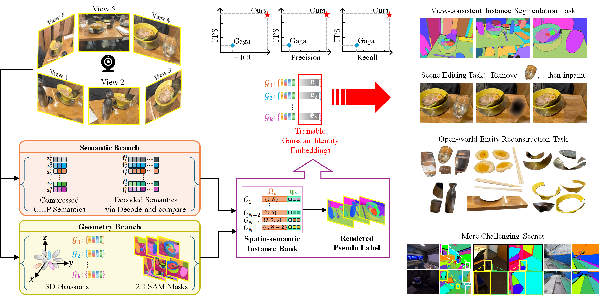

# SG-Group
This repository contains the official implementation of the paper **SG-Group: Semantic-Geometric Fusion for Robust 3D Gaussian Instance Segmentation via Decode-and-Compare**

> 💡NOTE: The manuscript is currently under review. This repository will be updated with additional details upon publication.

# Abstract
<!-- 如果要调整图片大小，需要用这个html命令，并改成自己github链接 -->

> Highlights:
> - SG-Group enables open-world view-consistent 3D Gaussian instance segmentation, mitigating association ambiguity and cross-view identity switching from single-modal-based grouping. 
> - SG-Group integrates geometric consistency and semantic affinity constraints to build a spatio-semantic instance bank for identity lifting, alongside a decode-and-compare strategy to balance storage cost and semantic discriminability. 
> - SG-Group can be plugged into existing 3D Gaussian frameworks without heavy redesign and maintains acceptable inference efficiency. 
> - SG-Group shows effectiveness on standard benchmarks, especially for scenes with heavy occlusion and similar adjacent objects, and supports further applications in scene editing and underground mine scenes.

# 1. Environment configuration
- Supported platforms: Linux or Windows Subsystem for Linux (WSL). 
- Install dependencies:
```bash
cd ROOT_DIR # Replace ROOT_DIR with the path to this repository on your machine.

pip install -r requirements.txt
pip install submodules/diff-gaussian-rasterization
pip install submodules/simple-knn
```

# 2. Preparation
- Dataset
  - LERF-Mask: Refer to [Gaussian Grouping Github repo](https://github.com/lkeab/gaussian-grouping/blob/main/docs/dataset.md) for download instruction.
  - Replica: Refer to [Gaga Github repo](https://github.com/weijielyu/Gaga/blob/main/USAGE.md#datasets) for download instruction.
  - ScanNet: Refer to [Gaga Github repo](https://github.com/weijielyu/Gaga/blob/main/USAGE.md#datasets) for download instruction.
  - MuSeg: Download [here](https://figshare.com/articles/dataset/_b_MUSe_b_b_g_b_b_b_b_A_multimodal_semantic_segmentation_dataset_for_complex_underground_mine_scenes_b_/28749098?file=55514594)
- Model checkpoint
  - SAM: Download [here](https://github.com/facebookresearch/segment-anything?tab=readme-ov-file#model-checkpoints). The SAM ckpts will be at `weight/sam_vit_h_4b8939.pth`, and you can set SAM_CHECKPOINT to the path of this file.
  - CLIP: Refer to [CLIP-ViT-B-16-laion2B-s34B-b88KP GitHub repo]() for usage. The CLIP ckpts will be saved automatically at `xxx/xxx.pth`
  - RGB Gaussian: `to be released`.

# 3. Usage
> - The pipeline currently supports COLMAP scenes. Please run COLMAP first to obtain camera poses and sparse point clouds before using this code.
> - Recommend logging the following information for debugging:
>   - `running command`
>   - `random seed`
>   - `python --version`: Python interpreter version
>   - `pip freeze`: Full snapshot of installed Python packages
>   - `nvcc --version`: Local CUDA toolkit compiler version (required if compiling custom CUDA kernels)
>   - `nvidia-smi`: GPU & NVIDIA driver version

### Main configuration
```bash
SCENE=/path/to/scene
RGB_MODEL=/path/to/rgb_model
OUT=/path/to/output
RGB_ITER=30000
SG_ITER=10000
EVAL_SPLIT=interval | replica
EVAL_HOLDOUT=8
export SAM_CHECKPOINT=/path/to/sam_vit_h_4b8939.pth
mkdir -p "$OUT"
```

### Training
```bash
# Step 1: Extract 512-D instance semantic embeddings
python preprocess_semantic.py --dataset_path "$SCENE" --sam_ckpt_path "$SAM_CHECKPOINT"

# Step 2: Train the feature compressor to compress these embeddings
python autoencoder/train_autoencoder.py --dataset_path "$SCENE" --output_path "$OUT/autoencoder" --epochs 100
python autoencoder/compress_features.py --dataset_path "$SCENE" --encoder_path "$OUT/autoencoder/encoder.pth"

# Step 3: Map the compressed embeddings to the RGB Gaussian model
python train_semantic.py -s "$SCENE" -m "$RGB_MODEL" \
  --start_checkpoint_iter "$RGB_ITER" --language_features_path "$SCENE/language_features_dim3" \
  --eval --eval_split "$EVAL_SPLIT" --eval_holdout "$EVAL_HOLDOUT"

# Step 4: Generate 2D SAM masks
python mask/get_raw_mask.py --dataset_folder "$(dirname "$SCENE")" \
  --scene "$(basename "$SCENE")" --seg_method sam

# Step 5: Build Spatio-semantic instance bank to generate pseudo labels
python associate_semantic.py -s "$SCENE" -m "$RGB_MODEL" --iteration "$RGB_ITER" \
  --seg_method sam --use_full_dim --semantic_weight 0.2 --semantic_threshold 0.6 \
  --combined_threshold 0.3 --autoencoder_path "$OUT/autoencoder/encoder.pth" \
  --eval --eval_split "$EVAL_SPLIT" --eval_holdout "$EVAL_HOLDOUT"

# Step 6: Train 16-D identity embedding for each 3D Gaussian primitive
python lift.py -s "$SCENE" -m "$OUT/final" --trained_model_path "$RGB_MODEL" \
  --object_path sam_mask_semantic --rgb_iteration "$RGB_ITER" --iterations "$SG_ITER" \
  --save_iterations "$SG_ITER" --checkpoint_iterations "$SG_ITER" \
  --test_iterations "$SG_ITER" --eval --eval_split "$EVAL_SPLIT" --eval_holdout "$EVAL_HOLDOUT"

# Step 7: 3D Instance segmentation via identity lifting 
python render.py -m "$OUT/final" --iteration "$SG_ITER" --skip_train
```

### Evaluation 
```bash
python eval.py --gt_masks /path/to/ground_truth_masks --pred_masks /path/to/output/final/test/ours_10000/objects_test
```

# Acknowledgement
This repository is based on the following GitHub repos. Thanks for their wonderful implementations!
- Gaussian Grouping: https://github.com/lkeab/gaussian-grouping
- Segment Anything: https://github.com/facebookresearch/segment-anything
- Gaga: https://github.com/weijielyu/Gaga
- simple-knn: https://gitlab.inria.fr/bkerbl/simple-knn
- Differential Gaussian Rasterization: https://github.com/graphdeco-inria/diff-gaussian-rasterization

# License
The license for original code is TBD. (Third-party](./THIRD_PARTY_NOTICES.md) licenses do not cover the entire project. The final license and citation will be added before public release.
